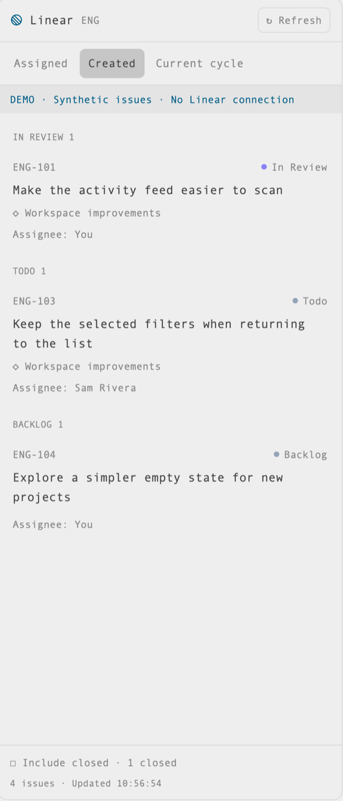

# Linear panel

Your Linear issues in a responsive native Herdr side panel. **macOS · Herdr 0.1.13**. [Recipe](RECIPE.md)



[Wide view](preview-wide.png). Both previews use synthetic demo issues.

## Views and refresh

All views use your configured team:

- **Assigned:** assigned to you.
- **Created:** created by you, including work assigned to someone else.
- **Current cycle:** in the active cycle and assigned to **or** created by you, without duplicates.

In Assigned and Created, choose **Group by: Status | Project**. Status is the default, and each tab remembers its choice. Project groups are alphabetical, with counts and a **No project** group at the end. Each project contains a flat, most-recently-updated-first list with issue statuses still visible. Current cycle stays grouped by status.

Rows stack when narrow and align into columns when wide. Workflow status, project, and assignee provide context; issue/project links open in Linear. **Include closed** reveals completed, canceled, and duplicate issues.

The panel fetches on initial load, reopen, and **Refresh**. Tabs load on first selection, then reuse their data until refreshed. There is no polling. A failed refresh keeps the last successful list with a stale notice.

For a synthetic preview, set `"demo": true` in your local config and press Refresh. Demo mode skips Keychain and network access. Remove the field or set it to false to return to live data.

## Manual install

The default Herdr home is `~/.config/herdr-app`. Use the home belonging to your intended app instance and preserve existing files.

1. Copy `mods/linear-panel/` into your Herdr home's `mods/` as an ordinary directory. Inspect existing copies before replacing anything; use copies rather than symlinks to keep source edits separate from the live UI.
2. Create `config/` if needed. Copy `config.example.json` to `config/linear-panel.json` only if absent, then enter your team key and workspace URL slug:

   ```json
   { "team": "ENG", "workspace": "example-workspace" }
   ```

3. Copy the installed `layouts/main.json` to **`layouts/herdr-setup-linear.json`**. In the copy, wrap `tabs` in a row named `tab-bar` if needed. Move its fixed height to the row and give `tabs` a `size` of `{"weight": 1}`. Append this button to the row:

   ```json
   {
     "id": "linear-button", "type": "block", "size": { "px": 86 },
     "content": { "mod": "linear-panel", "props": { "button": true } }
   }
   ```

   Preserve the existing `panel` column, its sizing and hidden state. Append this child to its `panel-body` stack, keeping existing children and selection:

   ```json
   {
     "id": "linear-panel", "type": "block",
     "content": { "mod": "linear-panel" }
   }
   ```

   Keep these IDs unique and unchanged: `panel` contains the `panel-body` stack, whose new child is `linear-panel`. Merge deliberately if your layout differs; leave shipped `main.json` untouched.
4. Set up credentials below, review the copied files, then check and activate:

   ```sh
   herdr-app check ~/.config/herdr-app/mods/linear-panel
   herdr-app do layout.switch '{"name":"herdr-setup-linear"}'
   ```

   For a custom home, use its path and matching app instance. Return to the shipped layout with `herdr-app do layout.switch '{"name":"main"}'`.

The [installer](../../README.md#install) performs the copies and layout edits, preserves valid config, and rejects conflicting files. You activate the layout separately.

## Credentials

Create a dedicated read-only Linear API key restricted to the team you need, then store it in **Keychain Access**:

1. Select your login keychain and choose **File → New Password Item**.
2. Set **Keychain Item Name / service** to `herdr-linear` and **Account Name** to `api-key`. Paste the key into the password field and save. Update an existing item rather than creating duplicates.
3. Allow the intended app's Keychain request when prompted, then press **Refresh** in the panel.

Keep the key in Keychain—not JSON, command literals, screenshots, Git, or bug reports. Use Keychain Access to rotate or remove it. For missing or denied credentials, check this item and its access permissions; leave other applications' credential stores alone.

## Access and maintenance

- The mod sends read-only queries to `https://api.linear.app/graphql`. Issue/project links are restricted to HTTPS on `linear.app`; team/cycle links use your configured workspace and team.
- Native `exec` access runs macOS `security` for Keychain retrieval and `open` for links. Mods are trusted native code: review `main.js`, `api.js`, and the remaining files before installing.
- Configuration and credentials belong to the local app context. Keep team/workspace settings outside the repository and use a dedicated key rather than another application's MCP tokens.
- Herdr live-reloads personal mods and layouts. Compare updates before copying; preserve shipped files, generated API definitions, and local edits. Installer `check` verifies packaging; native rendering and authentication need separate checks.
- To remove the panel, switch layouts, preserve your edits, then remove only its personal files. Retain the Keychain item if another tool uses it.

## Source

`mods/linear-panel/` contains the GPUI view (`main.js`), GraphQL client (`api.js`), filters/presentation helpers (`model.js`), synthetic data (`demo.js`), manifest, and icon. Herdr loads `main.js` through `gpui-kit` and `herdr`; layout `content.props` selects toolbar mode. Installed `herdr.d.ts` and `gpui-kit.d.ts` define the host API.

Node 26 is used for the optional installer and tests.
