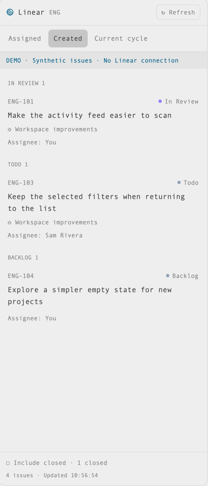

# Linear in the right-hand panel

A responsive native issue list beside your terminals: your assigned issues, issues you created, and your work in the configured team's active cycle. A Linear button lives beside Files and Changes. The panel is read-only; use Linear itself to edit issues.

[Wide responsive capture](preview-wide.png). Both images are native app captures, cropped to exclude the user's terminals and workspace.

## What you see

- An 86px toolbar block containing a 26px Linear button, selected while the panel is shown.
- The existing resizable right panel (368px initially, 280–900px in the installed main layout), with 10px corners and theme background/border colors.
- Header: Linear icon/title, configured team key, Refresh/loading control.
- Three wrapping selectors: Assigned, Created, Current cycle. Current cycle adds the returned cycle name (or number), dates and a link to the cycle.
- Actual workflow-status sections. Started states come first, then unstarted/backlog/triage; recently updated issues first in each section. Closed states appear only when Include closed is on.
- Below 620 logical pixels, rows stack identifier/status, wrapping title, project link and assignee. At 620px and wider, rows align an 84px identifier, flexible title/project, and 112px status/assignee column. Assignee is shown in Created/cycle, including You or Unassigned.
- Footer: Include closed toggle, closed count, total count and last successful update time. Counts reflect fully fetched, deduplicated data, not one page.
- Explicitly labeled Demo mode is available for synthetic previews without credentials or network access.

## How it behaves

- Assigned = configured team AND assignee is authenticated viewer.
- Created = configured team AND creator is authenticated viewer, even if assigned to someone else.
- Current cycle = configured team AND current active cycle AND (assigned to viewer OR created by viewer). Matching both predicates never duplicates a row.
- Load initially, when reopened, or on explicit Refresh. A new selector loads lazily; loaded selectors reuse their memory until refreshed. No background polling or terminal scanning. The active cycle is resolved again on cycle refresh.
- Clicking an issue or project opens its HTTPS linear.app URL in the system browser. The cycle title opens the configured team's active cycle. No embedded editor, comments, mutations, repository following or agent launching.
- Missing setup or failed initial load is shown as an error, not an empty list. Failed refresh retains the last successful list with an explicit stale notice. No active cycle is a distinct empty state.
- The button opens/closes the existing panel stack. Existing Files/Changes behavior and per-space panel visibility memory remain. The list is user/team-global, not tied to the selected terminal or remote machine.

## Built from

- Native GPUI modules in `mods/linear-panel/`: main.js (view/lifecycle/local Keychain and URL actions), api.js (GraphQL/pagination), model.js (config/filter/grouping/navigation checks), demo.js (synthetic fixtures), mod.json, icons/linear.svg.
- Layout `herdr-setup-linear.json` generated from installed main: wrap tabs in a tab-bar row; append a block using mod linear-panel with props `{ "button": true }`; add a linear-panel child to the panel-body stack. Keep panel ID panel and stack ID panel-body. Do not edit shipped tabs/main.
- Toolbar registers linear-panel in shared workspace.panels without replacing other entries. `layout.select`, `layout.show`/`hide` toggle it. Root `on_size_change` selects responsive row composition. Each async callback uses its own context; render must never call notify synchronously. Hidden panels do not render: the toolbar observes reopen transitions and emits a shared refresh-request counter from a task, which the panel consumes outside render. Regression tests must model both copies and skip hidden panel renders.
- Local config at appHome/config/linear-panel.json: team key, workspace slug and optional demo boolean. Derive viewer from the credential. Example values are ENG/example-workspace; never bake a workplace identity into source.
- Local Keychain item service herdr-linear/account api-key, read via exec security. Queries go directly to https://api.linear.app/graphql. Links open via exec open. No Pi MCP dependency, server or Node runtime inside Herdr. [Setup details](README.md).

## Watch out

- macOS Herdr 0.1.13 is the tested native target. Node 26 is installer/test-only. Installed generated guide/types are the host API authority; don't commit them.
- Full cursor pagination matters. Do not cap a personal/cycle list silently, fetch issue bodies/comments or create persistent data caches. Do not expose API keys or arbitrary remote error payloads in errors/logs.
- Mods are trusted native code with exec/network access, not mutually isolated plugins. Review every file and the access disclosure before installing. Keep credentials in Keychain, not JSON/command literals/Git. Never reuse another application's OAuth cache.
- Copy rather than symlink resources. Preserve existing conflicting mod/layout/config files. Installation does not activate the layout, restart Herdr or publish anything. A Git pull does not update live code; compare/copy deliberately.
- Herdr's shot command captures the last rendered frame; a covered window can retain an earlier frame. Inspect the actual image rather than assuming an acknowledged layout command has already appeared.

## Done when

- Native source is copied without overwriting conflicts; shipped main/settings remain unchanged.
- Native `herdr-app check <installed mod directory>` passes and status reports no errors.
- Toolbar opens the panel alongside Files/Changes, with readable narrow/default/wide rows and selector/cycle transitions.
- Team/actor/cycle predicates, pagination/deduplication, rollover/no cycle, grouping and failed refresh are covered with external-boundary stubs and synthetic fixtures.
- Real Keychain/API integration is verified separately when a dedicated read-only key is available; synthetic preview is not live API proof.
- Only a cropped native synthetic-data capture may become preview.png; no private terminal/workplace content in public assets.
